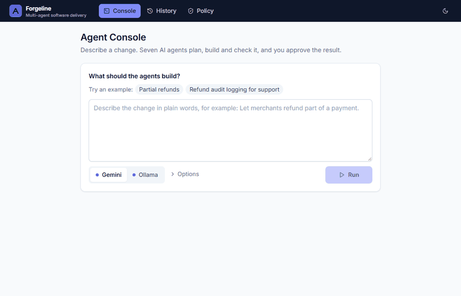
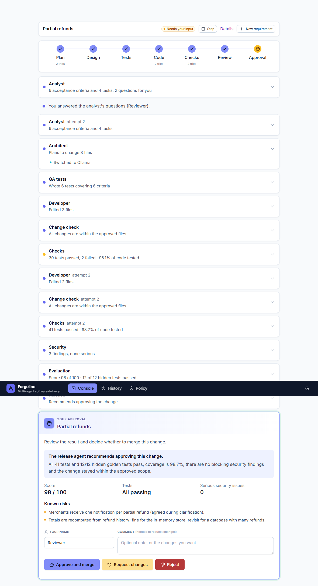
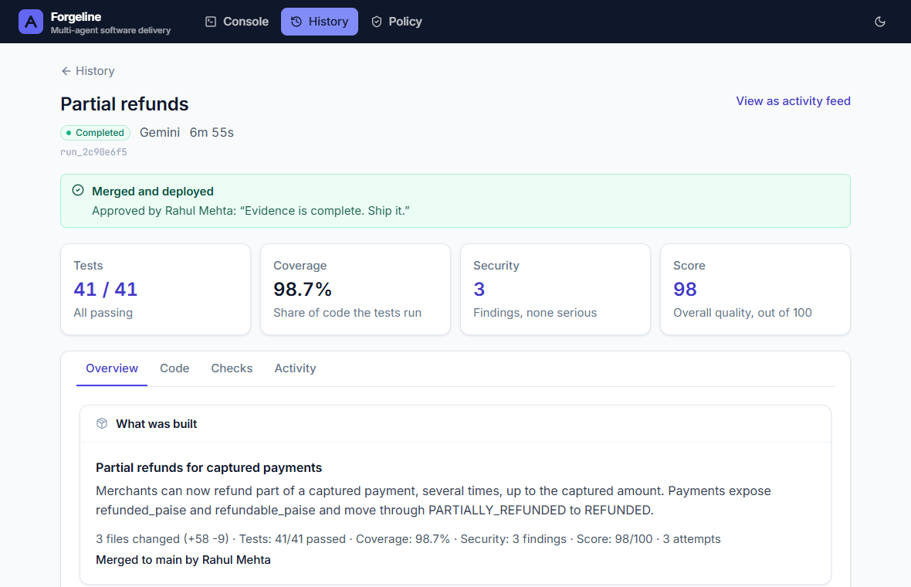
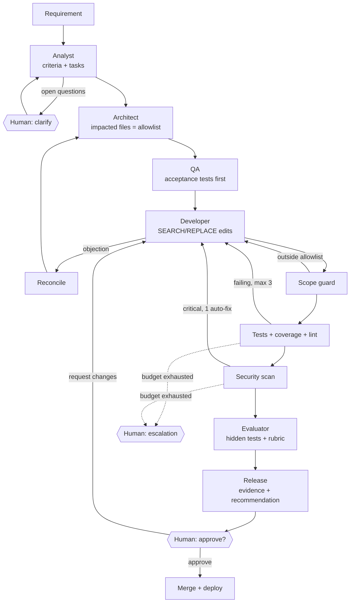
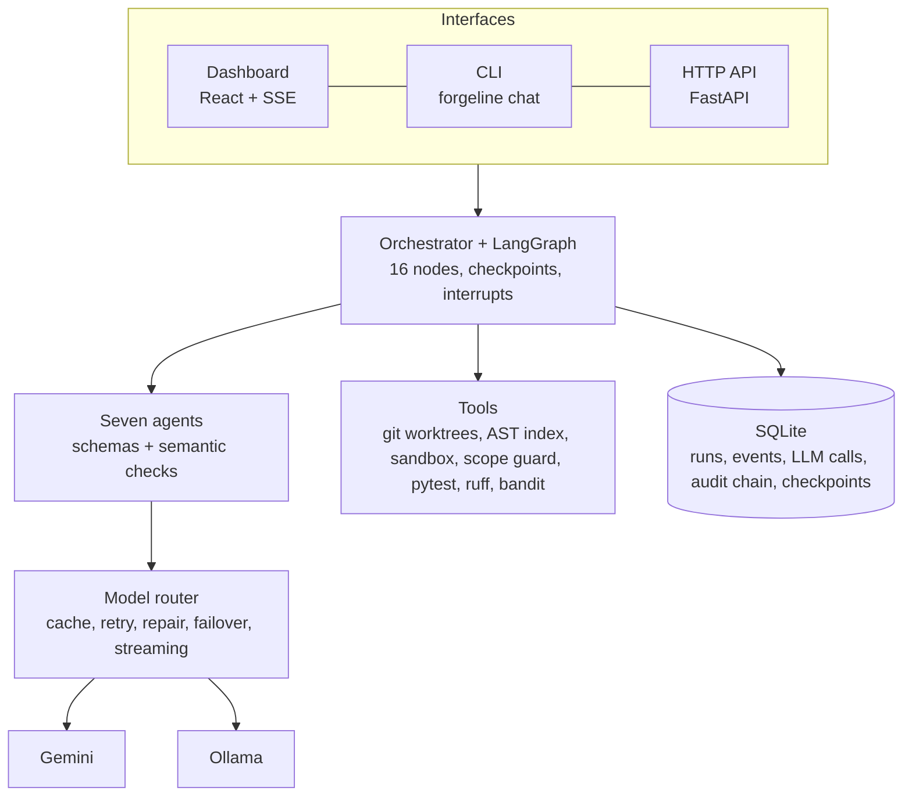

# Forgeline

**A multi-agent software delivery pipeline with human approval gates.**
Give it a product requirement; seven specialised agents clarify it, design the change, write tests first,
implement it on an isolated branch, run tests, lint and security checks, grade the result against a hidden
human baseline, and then **stop and wait for a person** before anything is merged.

[](https://github.com/Nishad-07/forgeline/actions/workflows/ci.yml)


[](LICENSE)

**[Try the live demo](https://nishad-07.github.io/forgeline/)** (sample data, runs in your browser) ·
[How it works](docs/HOW_IT_WORKS.md) · [Demo walkthrough](docs/DEMO.md) · [API](docs/API.md)



| Human approval gate with the evidence pack | A finished run: what was built, tests, coverage, score |
|---|---|
|  |  |

## Why this is different from a typical agent demo

Most agent demos chain prompts and hope. Forgeline treats the model as a **proposer** and ordinary code as the
**judge**, and it is explicit about where autonomy stops.

- **Deterministic verification.** Every change is checked by real tools: a scope guard, pytest with coverage,
  ruff, bandit and payment-specific security rules. A model can be confidently wrong; a failing test cannot.
- **Bounded autonomy.** Retries, repairs and design revisions run inside budgets defined in
  [`policy.yaml`](policy.yaml). When a budget runs out, a human decides.
- **Humans own the irreversible.** No agent can merge, deploy, accept a security risk or break a design deadlock.
- **Durable and resumable.** The workflow is checkpointed after every step. Kill the process, lose the model
  provider, come back tomorrow: it continues from the last completed step.
- **Honest evaluation.** Agents never see the hidden golden tests written by a human. The score compares their
  work with a human reference.
- **Observable.** Every step, model call, retry, failover and decision is an event; the audit log is hash-chained,
  so tampering is detectable.

## How a run flows



## Architecture



| Agent | Output contract | Job |
|---|---|---|
| Analyst | Given/When/Then criteria, tasks, questions | Clarify; ask a human when something important is open |
| Architect | Files to modify or create, untouched components, risks | Impact analysis; its file list is the Developer's allowlist |
| QA | A pytest file + the criteria it covers | Test-first acceptance tests, checked to fail for the right reason |
| Developer | SEARCH/REPLACE edits, or an objection to the design | Implement only the approved scope |
| Security | A verdict per static finding + extra concerns | Explain risk; static tools decide what blocks |
| Evaluator | 1-5 scores on five rubric criteria | Grade against the hidden baseline |
| Release | Criterion-to-evidence table, risks, recommendation | The evidence pack for the human approver |

## Failure handling

| Situation | What Forgeline does |
|---|---|
| Code fails tests | Failing test messages go back to the Developer; 3 attempts, then a human |
| Architect and Developer disagree | One reconciliation round, then a human breaks the deadlock |
| Critical security finding | Release blocked; one automatic fix; an override needs a written justification |
| Model returns malformed output | Repair prompt, retry at higher temperature, other provider, then a human |
| Model provider goes down | Retry, fail over (Gemini and Ollama), or pause and resume from the checkpoint |
| Agent repeats an action or edits an unrelated file | Idempotency ledger and scope guard refuse it before it touches disk |

Each row is covered by an end-to-end test that drives the real graph, git and pytest with a scripted model.

## Results from live runs

| Requirement | Outcome (Gemini) |
|---|---|
| Partial refunds | 33/33 tests, 97.9% coverage, **12/12 hidden tests**; attempt 1 failed 2 tests and was fixed on attempt 2; a real Gemini `503` triggered automatic failover to Ollama |
| Void a payment | 48/48 tests, 98% coverage, **10/10 hidden tests** on the first attempt |

## Quick start

Requires Python 3.11+, git and Node 20+ (for the dashboard). A free [Gemini API key](https://aistudio.google.com/apikey)
or a local [Ollama](https://ollama.com) install.

```bash
git clone https://github.com/Nishad-07/forgeline.git && cd forgeline
python -m venv .venv
source .venv/bin/activate            # Windows: .venv\Scripts\activate
pip install -e ".[dev]"
cp .env.example .env                 # add GOOGLE_API_KEY, or set FORGELINE_DEFAULT_PROVIDER=ollama
forgeline sample init                # creates the target repository the agents work on
forgeline doctor                     # checks tools, keys and models
```

Talk to the agents in the terminal (finish the requirement with a line containing only `.`):

```bash
forgeline chat --provider gemini
```

Or run the dashboard:

```bash
cd dashboard && npm install && npm run build && cd ..
forgeline serve                      # http://127.0.0.1:8000
```

For local models: `ollama pull qwen2.5-coder:3b` and `ollama pull qwen2.5-coder:7b`.

### CLI

| Command | Purpose |
|---|---|
| `forgeline chat` | Interactive session with live streaming and inline approval gates |
| `forgeline run requirements/partial_refund.md` | Run a requirement file |
| `forgeline status [RUN]` | List runs or show a timeline |
| `forgeline answer / approve / decide RUN` | Answer clarification, release and escalation gates |
| `forgeline resume RUN [-p ollama]` · `forgeline stop RUN` | Continue after an outage · stop a run |
| `forgeline metrics RUN` · `forgeline audit RUN` | Tokens, latency, cost · verify the audit chain |

## The sample project

Forgeline ships with **PayLite** (`sample_repo/`), a small FastAPI payments service, and six requirements in
`requirements/`: partial refunds, refund audit logging (a security trap), idempotent payment creation, voiding a
payment, listing a merchant's payments, and a daily transaction limit. Each has hidden golden tests and a human
reference solution in `baseline/`; `scripts/verify_baseline.py` proves the golden tests fail on the original code
and pass on the reference. You can also type any requirement of your own.

## Tests

```bash
pytest -n auto
```

132 tests, no network, no model cost: a scripted model drives the real workflow through every failure scenario,
plus unit tests for the router, tools, agents, store and API.

## Project layout

```
forgeline/
  agents/      seven agents, the SEARCH/REPLACE format, prompt helpers
  graph/       LangGraph state, nodes, routing
  llm/         Gemini / Ollama / mock backends and the router
  store/       SQLite store, hash-chained audit log, idempotency ledger
  tools/       git workspace, AST index, sandbox, scope guard, pytest/ruff, security scanner
  api/         FastAPI + server-sent events
  orchestrator.py · cli.py · chat.py · policy.py · schemas.py
dashboard/     React + Vite + Tailwind
sample_repo/   PayLite, the repository the agents change
requirements/  demo requirements      baseline/  hidden golden tests + reference solutions
tests/         132 tests              docs/      how it works, demo walkthrough, API
```

## Limitations and roadmap

- **Simulated deployment.** Approval merges into `main` of a local repository and records a deployment.
  Next: open a real pull request through the GitHub API.
- **Process-level sandbox.** Allowlisted tools, a confined working directory, secrets stripped from the environment
  and timeouts, but no container. Next: run checks in a network-less Docker container.
- **One target repository, Python only.** Next: point Forgeline at any local path or git URL.
- **Model speed and quotas.** Gemini's free tier is small; 7B local models are slow on laptop GPUs.
- **Non-deterministic models.** Live runs vary; the test suite is what guarantees each behaviour.

## License

[MIT](LICENSE)
